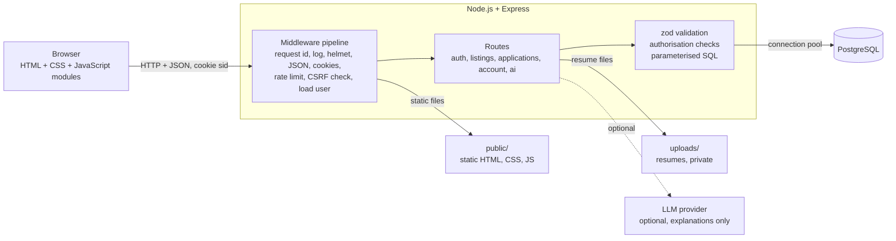
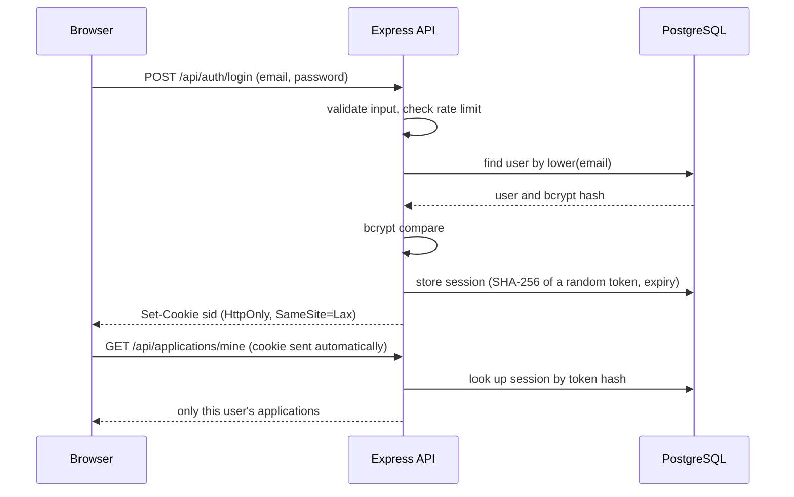
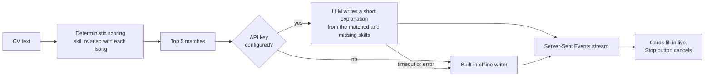
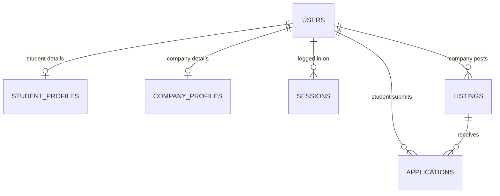

# Internly v2

Internly is an internship portal that connects **students** with **companies**. Students search and apply with a PDF resume, then track every application. Companies post listings, review applicants and accept or reject them.

**v2 is a solo rebuild** of my original university project ([sjv24/internly](https://github.com/sjv24/internly)). It keeps the same idea but is rebuilt properly: PostgreSQL instead of MySQL, a structured Express backend instead of one large file, real per-user authentication, and automated tests. The front end is plain **HTML, CSS and JavaScript** with no framework.

## Features

**For everyone**

- Search internships by keyword, location and type, with pagination (the filtering runs in the database, and the search updates as you type)

**Students**

- Sign up and log in, apply with a PDF resume and a cover note
- Track every application (pending, accepted, rejected) and withdraw pending ones
- **AI CV match:** paste a CV and get the best-matching internships, each with a score, the skills that matched or are missing, and a short explanation that streams in live (with a Stop button)

**Companies**

- Sign up and log in, create, edit and delete their own listings
- See applicants per listing, open their resumes, and accept or reject

**Under the hood**

- Per-user sessions in `httpOnly` cookies, bcrypt password hashing, role and ownership checks on every write
- Input validation, parameterised SQL, XSS-safe rendering, CSRF protection, rate limiting, private resume storage
- 49 automated tests, including security regression tests

## Tech stack

| Layer    | Technology                                                                  |
| -------- | --------------------------------------------------------------------------- |
| Frontend | HTML5, CSS3 (Flexbox, Grid, custom properties, media queries), ES-module JS |
| Backend  | Node.js 22, Express 5                                                       |
| Database | PostgreSQL (full-text search, constraints, indexes)                         |
| Security | bcrypt, cookie sessions, zod validation, helmet, express-rate-limit         |
| Tests    | Vitest, Supertest (against a real PostgreSQL), jsdom                        |

## Architecture



One Node process serves both the website and the API, so there is a single origin: cookies just work and no CORS setup is needed.

### How login and sessions work



### How the AI CV match works



The **score is computed by plain code** so it can be verified. The language model only writes the explanation, and if it is slow or unavailable the app falls back to a built-in writer.

### Database



## Getting started

Requires **Node.js 22 or newer**. No Docker and no database install: PostgreSQL is installed as an npm package.

```bash
npm install
npm run setup     # creates .env from .env.example
npm run dev       # starts PostgreSQL and the app
```

Open <http://localhost:3000> and log in with the demo accounts (password `Password123!`):

- Student: `student@internly.dev`
- Company: `company@internly.dev`

> On Windows PowerShell, if it says "running scripts is disabled", use `npm.cmd` instead of `npm`, or use Git Bash or `cmd`.

| Command                          | What it does                                                    |
| -------------------------------- | --------------------------------------------------------------- |
| `npm run dev`                    | database (port 54330) and app (port 3000), restarting on change |
| `npm test`                       | runs all 49 tests (the database must be running)                |
| `npm run db:reset`               | wipes the local database (it is recreated on the next start)    |
| `npm run db:seed -- --bulk 2000` | adds 2000 extra listings to try search and pagination at scale  |

To get model-written explanations in the AI match, put an API key in `AI_API_KEY` in `.env`. Without a key the app uses the built-in offline writer.

## Project structure

```
server/    Express app: routes, middleware, SQL access, AI matcher
public/    the website: HTML pages, css/styles.css, js/ modules (served as written)
db/        schema.sql
scripts/   local database and setup helpers
test/      automated tests
docs/      GUIDE.md: how everything works and how the files connect
```

See **[docs/GUIDE.md](docs/GUIDE.md)** for a file-by-file map, the request flows, the security measures and the front-end concepts used.

## Status and limitations

- Runs locally; it is not deployed.
- The AI explanations from a real model were not exercised against a live API key; the offline writer is what is tested.
- Resumes are stored on local disk, which is fine for local use but not for hosts with ephemeral storage.

## Future scope (October 2026)

I plan to rebuild the front end in **React** to keep up with the tools teams use today and make the UI easier to grow and maintain, introducing newer technology along the way. The backend, database and API would stay as they are.
